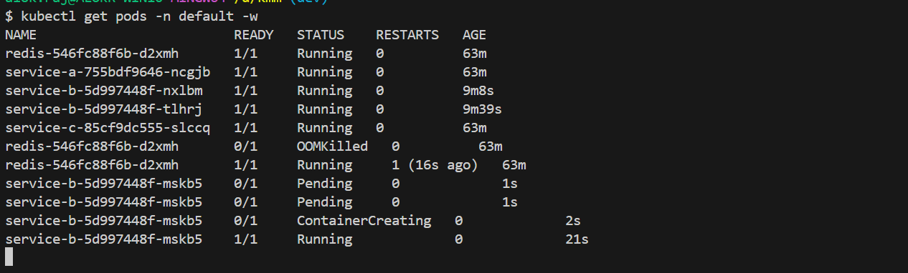
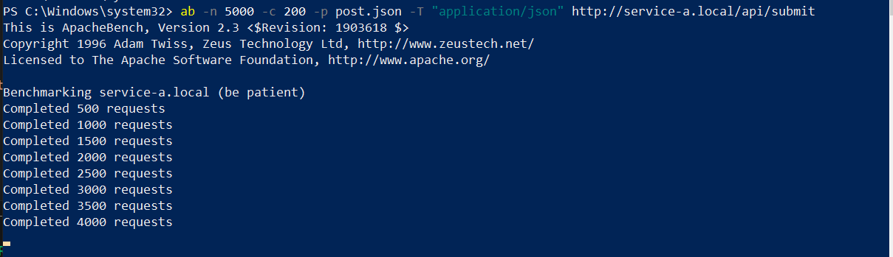
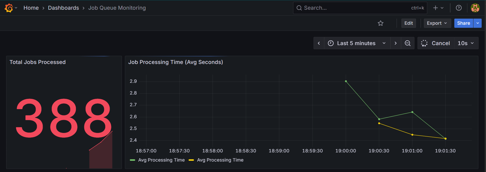
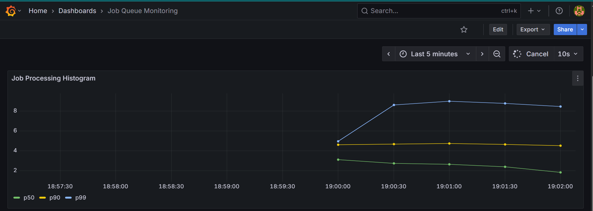
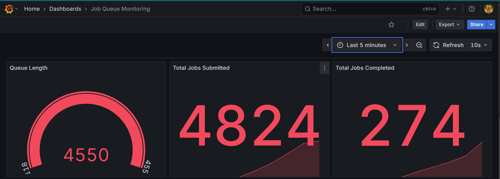
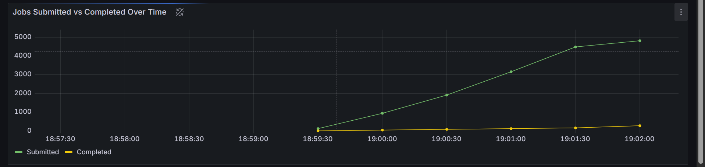

## 📦 Architecture Overview

### 🧱 Microservices

#### 1. **Service A – API Gateway / Job Submitter**
- Endpoints: `/submit`, `/status/:id`
- Accepts job requests and pushes them to **Redis queue**
- Returns job ID to the client

#### 2. **Service B – Worker (Horizontally Scaled)**
- Pulls jobs from Redis
- Performs **CPU-heavy operations**:
  - Prime number generation
  - bcrypt hashing
  - Array sorting
- Publishes **custom Prometheus metrics**:
  - `jobs_processed_total`
  - `job_processing_time_seconds`
  - `job_errors_total`

> **This is the only service that is auto-scaled by HPA.**

#### 3. **Service C – Stats Aggregator**
- Exposes `/stats` for job insights (count, queue length, averages)
- Prometheus metrics:
  - `total_jobs_submitted`
  - `total_jobs_completed`
  - `queue_length`

---

## ⚙️ Kubernetes Components

| Resource | Description |
|----------|-------------|
| **Deployments** | Service A, B, C, Redis |
| **Services** | Ingress (Service A), ClusterIP (B, C, Redis) |
| **HPA** | Applied on Service B (CPU > 70%) |
| **Monitoring** | Prometheus (scraping), Grafana (visualization) |

---

## 📁 Project Setup Instructions

### ✅ 1. Prerequisites

Ensure the following are installed:

- [Minikube](https://minikube.sigs.k8s.io/docs/start/)
- [kubectl](https://kubernetes.io/docs/tasks/tools/)
- [Apache Bench (`ab`)](https://httpd.apache.org/docs/2.4/programs/ab.html)

```bash
# Ubuntu/Debian
sudo apt install apache2-utils

# macOS
brew install httpd

# Windows (via Chocolatey)
choco install apache-httpd -y
````

---

### 📂 2. Clone the Repository

```bash
git clone https://github.com/alokrajmindfire/Kubernetes-Microservices-Monitoring.git
cd Kubernetes-Microservices-Monitoring
```

---

### 🔐 3. Configure Docker Image Names

Edit the `script/build-images.sh` script:

```bash
DOCKER_USERNAME=<your-docker-username>
```

Update image references in the deployment YAMLs:

```yaml
# Example (k8s/deployment/deployment-a.yaml)
containers:
  - name: service-a
    image: <your-docker-username>/service-a:0.1
```

Files to edit:

* `k8s/deployment/deployment-a.yaml`
* `k8s/deployment/deployment-b.yaml`
* `k8s/deployment/deployment-c.yaml`

---

### 🚀 4. Build & Deploy to Minikube

```bash
cd script
chmod +x ./build-images.sh ./deploy.sh

# Build Docker images (make sure Minikube Docker env is active)
eval $(minikube docker-env)
./build-images.sh

# Deploy all services and monitoring tools
./deploy.sh
```

Verify:

```bash
kubectl get pods -A
kubectl get svc -A
minikube service list
```

---

### 🧭 5. Access Services

#### Start Minikube tunnel:

```powershell
minikube tunnel
```

#### Update Windows Hosts File (PowerShell):

```powershell
Add-Content -Path "C:\Windows\System32\drivers\etc\hosts" -Value "127.0.0.1 prometheus.local grafana.local service-a.local"
```

---

## 📊 Monitoring with Prometheus & Grafana

### 1. Grafana Access

```bash
minikube service -n monitoring monitoring-grafana
```

* Default credentials:

  * **Username:** `admin`
  * **Password:** `prom-operator`

### 2. Import Dashboard

* Navigate to: **Dashboards → Import**
* Upload: `git-assets/job-queue-dashboard.json`

### 3. Observe:

* CPU/Memory usage per pod
* Queue length, processing time
* Number of active replicas (HPA scaling)
* Custom metrics exposed by Services B & C

---
## 📊 Resource Usage Summary

Each service is configured with specific CPU and memory **requests and limits** to optimize performance, enable autoscaling, and ensure Kubernetes schedules them efficiently.

| Service       | CPU (Request → Limit) | Memory (Request → Limit) | Scalable? | Replicas |
|---------------|------------------------|----------------------------|-----------|----------|
| **Service A** | 2 → 2 cores             | 512Mi → 1Gi                | ❌ No     | 2        |
| **Service B** | 250m → 500m            | 512Mi → 1Gi                | ✅ HPA    | 2 → 10   |
| **Service C** | 250m → 500m            | 256Mi → 512Mi              | ❌ No     | 1        |
| **Redis**     | 1 → 2 cores             | 2Gi → 4Gi                  | ❌ No     | 1        |

> 🔄 **Horizontal Pod Autoscaler (HPA)** is configured only for **Service B**, scaling from 2 up to 10 replicas based on CPU usage.
>  
> 🗃️ **Redis** is deployed as a `StatefulSet` in its own namespace (`caching`) with persistent storage (5Gi PVC) and a custom config for optimized memory use.


## 🔥 Stress Testing the System

### 1. Prepare Payloads (Windows PowerShell)

```powershell
# Prime job
echo '{ "type": "primeCalc" }' | Out-File -Encoding ascii post.json

# Bcrypt
echo '{ "type": "bcryptHash" }' | Out-File -Encoding ascii post.json

# Sort array
echo '{ "type": "sortArray" }' | Out-File -Encoding ascii post.json
```

### 2. Run Load Test

```powershell
# Using Minikube IP
ab -n 5000 -c 200 -p post.json -T "application/json" http://$(minikube ip)/api/submit

# Or using service-a.local (after hosts update)
ab -n 5000 -c 200 -p post.json -T "application/json" http://service-a.local/api/submit
```

> `-n 5000`: number of requests
> `-c 200`: concurrent requests

---

## 📈 Horizontal Pod Autoscaling (HPA)

### 1. Watch HPA

```bash
kubectl get hpa service-b-hpa --watch
```

### 2. View Logs

```bash
kubectl logs -f deploy/service-a
kubectl logs -f deploy/service-b
kubectl logs -f deploy/service-c
```

---

## 🧹 Cleanup

```bash
cd script
chmod +x ./cleanup.sh
./cleanup.sh

minikube stop
minikube delete
```

---

## 📸 Observations: Scaling & Monitoring

### HPA Scaling Behavior



* **Initial State**:

  * 2 worker replicas
  * Low CPU

* **Under Load**:

  * CPU spikes
  * HPA scales workers from **2 → N** based on target utilization

---

### 📷 Grafana Dashboard Screenshots

> During stress testing of Service A

| Description        | Screenshot                  |
| ------------------ | --------------------------- |
| Stress Test Graphs |  |
| CPU Usage          |  |
| Job Metrics        |  |
| Queue Length       |  |
| Scaling Activity   |  |

---

## 📝 Notes

* You **must update `DOCKER_USERNAME`** before building images.
* `./deploy.sh` deploys all services and monitoring tools.
* Use `ab` or other tools like `k6`, `wrk`, or `hey` for advanced load testing.
* HPA relies on CPU usage — ensure your workload is CPU-heavy (e.g. bcrypt, prime calc).

---